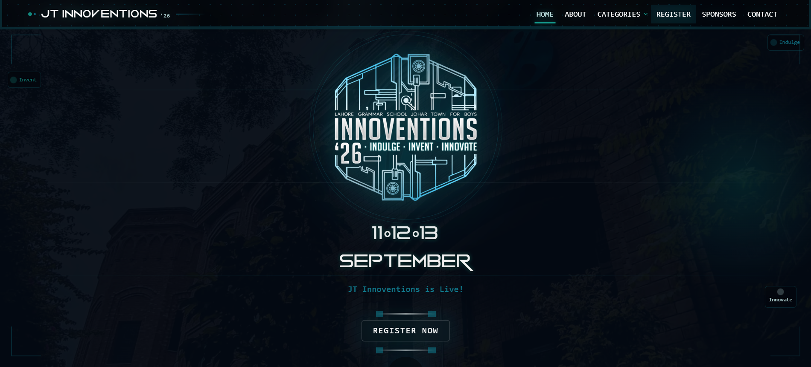
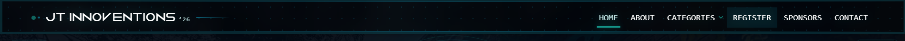
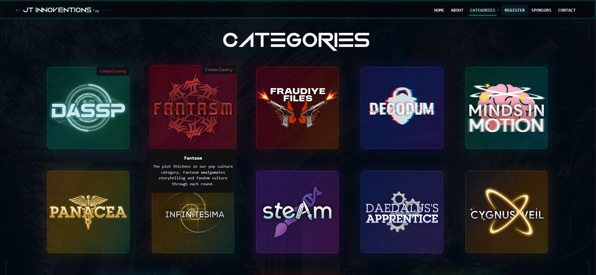
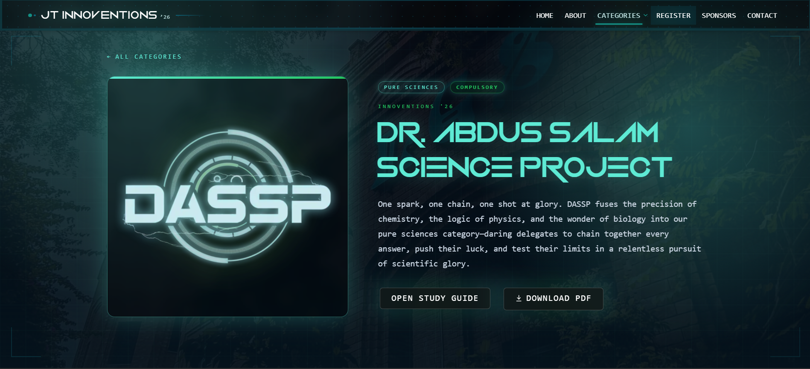
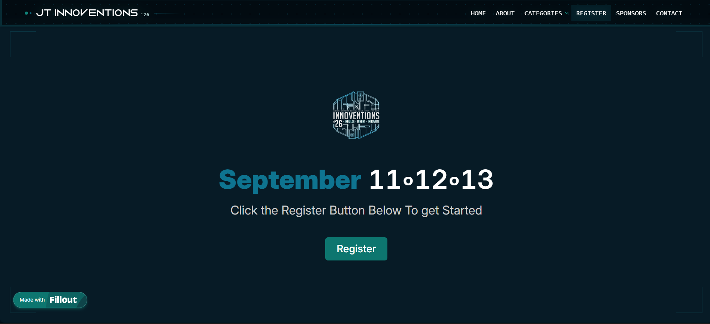
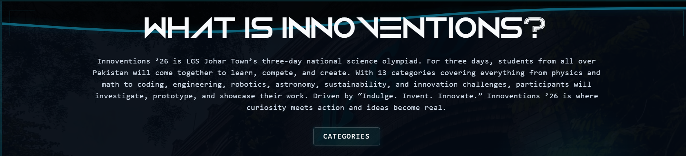
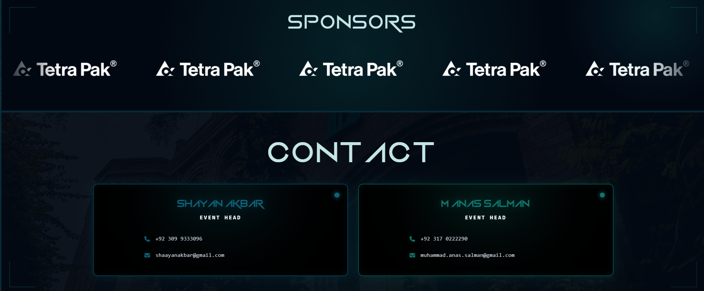
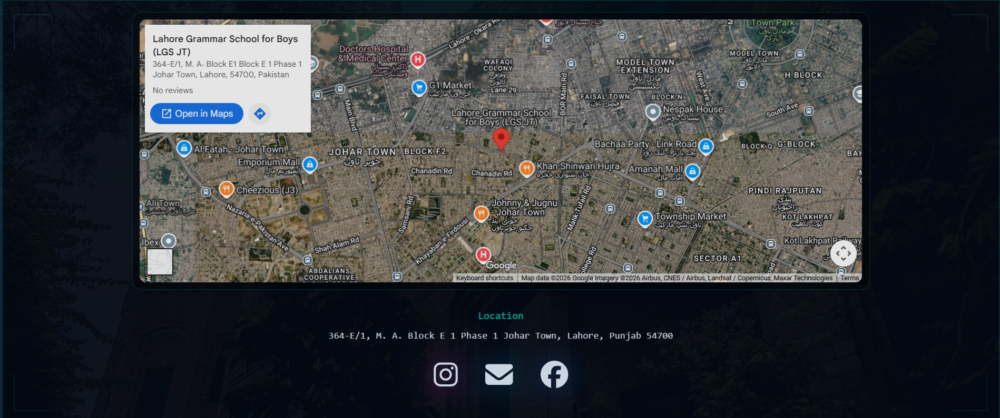
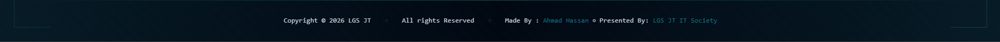

# JT Innoventions '26

The website for LGS JT Innoventions '26, LGS JT's three-day science olympiad. For Delegates to browse categories, review study guides, and to register for the event.



## Visit the Webiste
Click to Open Website: [Visit the Website](https://lgsjtinnoventions.com/) 

```bash
https://www.lgsjtinnoventions.com/
```

Alternate Domain for Developments: [Vercel URL](https://jtinno26.vercel.app/)

```bash
https://jtinno26.vercel.app/
```

## Running locally

You'll need Node.js and npm installed. From the project folder, run:

```bash
npm install
npm run dev
```

Open [localhost:5173](http://localhost:5173/) to see the site. Changes you save will show up in the browser while the development server is running.

## Features

- Website is used by delegates to get a know-how of the event and their specific categories
    - In the background we have the school's picture followed up by a black overlay to create tech vibes.
    - The cursor has a `Hover Glow Effect` 

- The Header
    - The Header or the navigation bar had some unique features such as `Scroll Response`. Wehnever the user scrolls to a new section the header is updated accordingly.
    - For categories a `Drop Down Menu` was added for even easier navigation.
    

- Hero
    - Tried to keep it simple, user is met by:
        - logo 
        - date 
        - timer *(now that the event is over, the countdown timer has automatically switched to a text message)*
        - registration button *(most imp as this is what they are here for)*
        
        

- The Category Page displays the logos of each category and allows users to download the study guides for each one of them.
    - On hover a small decription is shown.
    
    - When clicked users are redirected to specific category pages where they can download the studyguide or it in browser is given.
    

- The registrations section.
    - The form was made in `Fillout Forms` which was integerated with `Google Sheets` so that the Event Management team could easily configure who has registered for the event.
    
    *Note: Registration form is closed now.*

- About Section
    - Simple description about the event and its history.
    

- Sponsor(s) + Contact Section
    

- Location + Links
    

- Footer
    - For credits and rights reservation
    

***Made by: Ahmad Hassan***